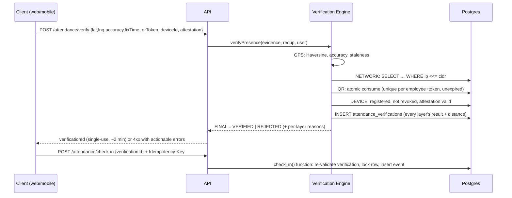

# TeachGrow Attendance Management System — Architecture

Status: **Draft v1 for approval (Phase 2).** No application code exists yet.
Last updated: 2026-11-05.

## 1. Starting point (Phase 1 findings)

| Item | Finding |
|---|---|
| Existing TeachGrow Employee Portal | **None exists.** Confirmed by the project owner. This is a greenfield build. |
| Starting directory | Empty and not a git repository. |
| Other projects on the development machine | Several unrelated projects were inspected while looking for the portal (a student LMS, an AI-voice app, a CRM and others). None is an employee portal. None is reused or modified, and their `.env` files were not read. |
| Toolchain present | Node 24, npm 10, Git 2.46, Docker 29, Java 17, Android SDK. |
| Toolchain missing | Supabase CLI, Expo/EAS CLI (both runnable via `npx`), `psql`, `pnpm`. |
| Platform limits | Windows host: **iOS cannot be built or run locally.** iOS is delivered via EAS cloud builds and verified on a real device or Mac. |

Because there is no legacy code, the "safe integration strategy" is: build in isolation in this repo, on a **dedicated Supabase project**, with no shared database, auth or keys with any other TeachGrow system.

## 2. System overview

```
                         ┌────────────────────────────────────────────┐
  Employee browser ─────►│                                            │
  (Vite SPA, PWA)        │   Express API  (Node 24, TypeScript)       │
                         │   - authN (Supabase JWT) / authZ (roles)   │
  Employee phone   ─────►│   - Verification Engine (GPS/IP/QR/Device) │──► Supabase Postgres
  (Expo app)             │   - Attendance + Break engines             │    (RLS, RPC functions,
                         │   - Reports, Notifications, Audit          │     pg_cron, Realtime)
  Admin browser    ─────►│                                            │
  (same SPA, /admin)     └───────────────┬────────────────────────────┘
                                         │
  Office display   ─────►  GET /api/office/qr/current (display role)
  (/office/qr screen)                    │
                                         ├──► Supabase Auth (users, sessions)
  Supabase Realtime ◄── admin dashboard  ├──► FCM (mobile push)  /  Web Push (VAPID)
  (RLS-filtered)                         └──► Play Integrity / App Attest verification
```

**Principle: the server is the only source of truth.** Clients send raw evidence (coordinates, QR payload, attestation). Clients never send "I am verified", a timestamp to be trusted, or a computed status.

## 3. Repository layout (npm workspaces)

```
attend/
  apps/
    api/        Express 5 + TypeScript  — all business logic
    web/        Vite + React + TS + Tailwind + shadcn — employee AND admin (separate layouts/routes)
    mobile/     Expo + React Native + TS — employee app (Android + iOS)
  packages/
    shared/     Zod schemas, DTO types, enums, constants (single source for web/mobile/api validation)
  supabase/
    migrations/ Ordered SQL migrations (schema, RLS, functions, cron)
    tests/      pgTAP / SQL-level RLS tests
  docs/         Architecture, API, env vars, security, threat model, deployment, admin guide
  e2e/          Playwright (web) and Maestro (mobile) flows
```

- `packages/shared` may be imported by clients for **form validation and display only**. The API re-validates everything.
- The office QR display is a route in `apps/web` (`/office/qr`), not a separate app.

## 4. Authentication and sessions

Spec asks for both Supabase Auth and `POST /api/auth/login`. Resolution:

- Supabase Auth owns users, password hashing, refresh tokens and password reset.
- `POST /api/auth/login` calls Supabase Auth server-side, applies our rate limit and lockout, checks `profiles.is_active`, writes an audit event, and returns a session.
- **Web:** access token held **in memory**. Refresh token in an `HttpOnly; Secure; SameSite=Strict` cookie scoped to `/api/auth`. CSRF is handled for cookie-authenticated endpoints (refresh, logout) via `Origin` allowlist check plus a required custom header. All other API calls use `Authorization: Bearer`, which is not CSRF-able.
- **Mobile:** access and refresh tokens in Expo SecureStore. Bearer only.
- The API verifies the JWT signature locally (Supabase JWKS, or the legacy shared secret), then loads `profiles` + role from the DB on each request **and checks that the token's session still exists in `auth.sessions`**. Deactivation, role changes and logout take effect on the next request and are not left to the token lifetime.
- No self-signup. Only admins create employees (`POST /api/admin/employees`), through the Supabase Admin API on the server.
- **Implemented in Phase 4** (details, endpoints, limits and verification status in [AUTH.md](AUTH.md)): sign-in with durable audit-log-based lockout, refresh with rotation and reuse detection, idempotent logout, forced first-login password change, admin employee/department management, deactivation that also bans the user at the provider and revokes sessions, the first-administrator CLI, and Row Level Security that requires an active profile.
- Two refinements to the original text: the refresh endpoint is `POST /api/auth/refresh`, and `POST /api/auth/change-password` exists so that temporary passwords handed out by administrators are never kept. Supabase's JWT expiry should be set to **15 minutes**.

### Roles

`roles` table seeded with `employee`, `admin`, `office_display`.
`office_display` is a least-privilege kiosk identity. It can only call `GET /api/office/qr/current`, so a lobby screen never holds an admin session.

## 5. Database

Supabase PostgreSQL, migrations in `supabase/migrations`, applied by the Supabase CLI.

### 5.1 Required tables (14)

`profiles`, `roles`, `office_locations`, `office_networks`, `registered_devices`, `attendance_records`, `attendance_events`, `attendance_verifications`, `break_records`, `attendance_policies`, `holidays`, `attendance_corrections`, `audit_logs`, `qr_tokens`.

### 5.2 Supporting tables the spec implies but does not list

| Table | Why it is needed |
|---|---|
| `departments` | Spec requires a normalized schema and department filtering. Avoids free-text department strings. |
| `leave_records` | Spec defines an "On Leave" status and an "Employees on leave" KPI but lists no source of leave data. Minimal admin-entered approved leave (employee, date range, type, approver). **Not** a full leave-request workflow. |
| `push_subscriptions` | FCM tokens and Web Push subscriptions per device. |
| `notifications` | Delivery log with `UNIQUE (user_id, dedupe_key)` to guarantee no duplicate notifications. |
| `announcements` | Source for "important admin announcements". |
| `idempotency_keys` | Stored responses for idempotent check-in, check-out and break calls. |
| `checkout_exceptions` | Admin-authorized exception to check out while a break is active. |

### 5.3 Key modelling decisions

- **Append-only events.** `attendance_events` (`CHECK_IN`, `CHECK_OUT`, `BREAK_START`, `BREAK_END`, `CORRECTION_APPLIED`, …) is insert-only. A trigger rejects `UPDATE` and `DELETE`. `audit_logs` has the same protection.
- **`attendance_records`** is one row per employee per `work_date`, `UNIQUE (employee_id, work_date)`. It is a derived summary of the events.
- **Corrections never overwrite.** An `attendance_corrections` row stores the original snapshot, the proposed values, reason, admin ID and timestamp. Applying one appends a `CORRECTION_APPLIED` event and recomputes the summary with the correction layered on. The original events stay readable.
- **Independent flags.** Status and flags are separate columns:
  - `status`: `PRESENT | LATE | ABSENT | INCOMPLETE | ON_LEAVE | WEEKLY_OFF | HOLIDAY`
  - `is_half_day`, `is_early_checkout`, `overtime_minutes`: independent of status. A day can be `LATE` **and** half-day.
- **Time.** All instants are `timestamptz` generated by the database (`now()`) or the API clock, never by the client. `work_date` is derived server-side in the policy timezone (`Asia/Kolkata`).
- **Breaks.** `break_records` has a partial unique index on active breaks, plus a `tstzrange` exclusion constraint (`btree_gist`) so overlaps are impossible at the DB level, not only in application code.
- **Network allowlist** stored as Postgres `cidr`. Matching is done in SQL with `inet <<= cidr` for IPv4 and IPv6.
- **Soft deactivation.** `is_active` / `revoked_at` / `deactivated_at`. Nothing that has attendance history is hard-deleted.

### 5.4 Authorization model: RLS plus server-side checks

- The API connects with the **service-role key, which exists only in the API's server environment**. It never reaches web or mobile bundles.
- RLS is enabled on **every** table, with no policies for `anon`.
- Employee clients get `SELECT`-only access to **their own** rows of: records, events, breaks, devices, leave, corrections, notifications. They have **no** `INSERT/UPDATE/DELETE` on any table, so even a leaked employee JWT cannot forge attendance via PostgREST.
- **Verification evidence (GPS fixes, IPs), office configuration and the audit log are admin-only on direct table access.** Employees see their own verification _outcome_ through the API, never the raw evidence. `qr_tokens`, `qr_scan_events`, `idempotency_keys` and `push_subscriptions` are readable by no client role at all, not even admins.
- Reference data (policy, holidays, departments, roles) is readable by every signed-in user.
- Admin `SELECT` policies use a `SECURITY DEFINER` helper `is_admin()`. This is also what makes **Supabase Realtime** safe: the admin dashboard subscribes with its own JWT and only receives rows RLS allows.
- All writes go through the API, which calls **PL/pgSQL functions** (`check_in`, `check_out`, `start_break`, `end_break`, `apply_correction`). Each runs in one transaction with `SELECT … FOR UPDATE` on the day's record, so state transitions are atomic and race-free.
- RLS is defense-in-depth. The primary control is the API's role middleware plus the DB functions.

## 6. Verification engine (the critical path)

A single module, `apps/api/src/verification/`, with one entry point, `verifyPresence(input, context)`. No endpoint evaluates a layer on its own.

### 6.1 Flow



### 6.2 Layer rules

| Layer | Rule | Notes |
|---|---|---|
| **GPS** | Haversine distance ≤ `geofence_radius_m` (default 100). Reject if `accuracy > max_accuracy_m`. Reject if the fix is older than `max_fix_age_s` or in the future relative to server time. | Radius and thresholds are admin-configurable. Distance is stored for every attempt. A reading the device flags as `mocked` is rejected, but the flag is cooperative: its absence proves nothing, which is why GPS is only one of four layers. |
| **Office network** | `req.ip` must match an active `office_networks` CIDR. | Express `trust proxy` is set to an explicit hop count or CIDR list from env. `X-Forwarded-For` is never read directly. Tests prove forged forwarding headers are ignored. |
| **QR** | A 256-bit code derived per rotation window with HMAC-SHA256 from `QR_SIGNING_SECRET`, so no plaintext is stored; only its **SHA-256** is kept, once somebody scans it. Window = rotation interval (30 s default), accepted 5 s early and 10 s late. Consumption is one `ACCEPTED` scan per employee, enforced by a unique index. | See decision D1 below and [VERIFICATION.md](VERIFICATION.md). |
| **Device** | Device must be registered, approved, not revoked, and must sign a fresh single-use challenge with its own key. | See §6.3. |

`FINAL_RESULT = VERIFIED` only if **every layer required for that channel** passes. Required layers per channel (web vs mobile) are policy configuration. Every attempt, pass or fail, is written to `attendance_verifications`, and there is no code path that skips this.

### 6.3 Device identity

- **Native (Expo):** an app-generated ECDSA P-256 key held in the device's key store, which signs a server challenge for every check-in (**implemented in Phase 5**). **Play Integrity** (Android) and **App Attest** (iOS) are meant to add proof of a genuine app build; they need a custom dev build and external accounts (Google Cloud project, Apple Developer Program), and do not work in Expo Go. They are **not implemented yet**: the `AttestationVerifier` interface exists, native registrations are recorded with provider `NONE`, and the real verifiers arrive with the mobile app in Phase 9.
- **Web:** browser fingerprints are not identity. The registered "device" is a **WebAuthn platform credential (passkey)** with user verification required (**implemented in Phase 5**), so each check-in needs a signed assertion from a key held by the machine. A passkey the platform syncs between a person's devices is not tied to one machine; this is recorded at registration for the approving administrator. If the company prefers not to do this, the alternative is a *documented per-channel policy* that marks the device layer `NOT_REQUIRED (web)` in the verification record. It is never silently skipped.
- **Registration is gated.** Password re-authentication (with the sign-in lockout) plus admin approval; a new device stays `PENDING` until approved. There is a per-employee device cap (policy setting, default 2). Employees can remove their own devices and admins can revoke any, and revocation is effective on the next request. The full design is in [VERIFICATION.md](VERIFICATION.md).

### 6.4 Admin "Test office configuration"

`POST /api/admin/office/test` evaluates sample coordinates plus the caller's observed IP against the saved config and returns per-layer results. It writes nothing to attendance tables.

## 7. Attendance and break engines

State machine per employee per day, enforced inside the DB functions:

```
NOT_STARTED ──check_in──► WORKING ──start_break──► ON_BREAK(lunch|short)
                              ▲                          │
                              └──────── end_break ───────┘
WORKING ──check_out──► CHECKED_OUT        (blocked while ON_BREAK unless a checkout_exception exists)
```

- `net_minutes = (check_out − check_in) − Σ recorded_breaks`. An open day is computed against server `now()` for the live counter.
- Lunch allowance (60 min) is displayed as *remaining allowance*. Per the spec formula, **all recorded breaks are deducted** from net hours.
- Late: local check-in time ≥ `late_threshold` (10:20). Present otherwise.
- Half-day, overtime, early-checkout use configurable thresholds in `attendance_policies`. **No payroll deductions or penalties are computed anywhere.**
- Policies are versioned with an effective date, and each day's record stores a **snapshot of the policy in force at check-in**. Editing a rule never reclassifies a day that has already started: break limits, half-day, overtime and early-checkout rules all apply from the _next_ check-in. This is covered by tests.
- Half-day, overtime and early-checkout rules ship **disabled** because the brief gave no thresholds; an administrator enables them with real values.
- A work date is finalized at **02:00 local time the following day** (so late-night checkouts still land on the open record). Dates before the office was first configured are never finalized.
- **Day finalization:** a `pg_cron` job calls `finalize_attendance_day(date)`. It is idempotent and marks `ABSENT` (no check-in, not leave, not holiday, not weekly off) and `INCOMPLETE` (no check-out). It uses holiday, leave and weekly-off data. Missing-checkout notifications run shortly after closing time.
- Idempotency: `Idempotency-Key` header on check-in, check-out, and break calls. The same key returns the stored result. A different key on an already-checked-in day returns `409`.

## 8. Notifications

- Mobile: Firebase Cloud Messaging (via `firebase-admin`, covers Android and iOS through APNs configured in Firebase).
- Web: Web Push (VAPID). On iOS, web push only works for an installed PWA.
- Every send goes through one `notify()` function that inserts into `notifications` with `UNIQUE (user_id, dedupe_key)` first, then sends. A retry or double-trigger can't produce a duplicate.
- Events: check-in success, checkout success, failed verification, missing checkout, correction updates, announcements.

## 9. Reports

Server-side queries, scoped by the caller's role. CSV is streamed, Excel via `exceljs`. Exported cells beginning with `= + - @` are neutralised (CSV/formula injection). Reports use the stored event data, so a corrected day shows the corrected values with the correction visible in the audit trail.

## 10. Security summary

Full detail goes in `docs/SECURITY.md` and `docs/THREAT_MODEL.md` (Phase 11). Baseline controls:

- Helmet headers and a strict CSP. CORS allowlist from env. HSTS. HTTPS terminated at the host.
- `express-rate-limit` per IP and per account on auth, verify, and QR endpoints. A shared store (Redis) is required if more than one API instance runs.
- Zod validation on every request body, query and param. Parameterized queries only (no string-built SQL).
- Audit log for logins, verification outcomes, device events, config changes, corrections, exports, and admin actions. Append-only.
- Secrets only in server environment variables. `.env` files are git-ignored. `.env.example` files hold placeholders only.
- **Location privacy:** coordinates are read once per verification attempt and never tracked in the background. The UI explains why before the OS permission prompt. Proposed retention (needs company/legal sign-off, and India's DPDP Act 2023 obligations should be confirmed with counsel): raw coordinates nulled after 90 days (verdict and distance kept), `qr_tokens` purged after 7 days, `audit_logs` retained 2 years, attendance records retained per company policy.

### Known limitations (will be documented honestly in the threat model)

- **GPS spoofing:** server cannot prove a coordinate is real. Mitigated by IP, QR and device layers, not eliminated.
- **VPN / proxy:** a VPN exiting through the office IP defeats the network layer alone. Mitigated by the other layers.
- **QR sharing:** a photo of the displayed QR can be sent to a colleague within its TTL. Mitigated by GPS + IP + device being required together.
- **Network changes:** ISP IP changes will cause legitimate rejections until an admin updates the allowlist. Cellular data (carrier IPs) will not pass the network check, so employees must be on office Wi-Fi.
- Rooted/jailbroken or emulated devices are only partially detectable via attestation.

## 11. Hosting and deployment (proposal)

- **API:** persistent Node container (Render / Railway / Fly.io or a VPS). It is not a good fit for pure serverless: rate-limit state, cron-adjacent jobs and long-lived connections all prefer a long-running process.
- **Web:** static build on any static host/CDN (Vercel, Netlify, Cloudflare Pages), or served by the API.
- **Database/Auth/Realtime:** a dedicated Supabase project (separate from any other TeachGrow system).
- **Mobile:** EAS Build (cloud) for Android and iOS. Android can also be built locally here.
- The correct `trust proxy` value depends on the host (for example Cloudflare/Fly add their own client-IP header). It is set per environment, and tested in staging before go-live.

## 12. Interpretations of the spec

1. `DELETE /api/devices/`, `PUT /api/admin/employees/` and `DELETE /api/admin/office/networks/` were written without an identifier. They are implemented as `…/:id`.
2. "Each QR token must be single-use" conflicts with one QR shown on one screen for many employees. See **D1** in the implementation plan.
3. The 14-table list omits tables that other requirements need. See §5.2.
4. Check-**out** verification is not specified. See **D3**.
